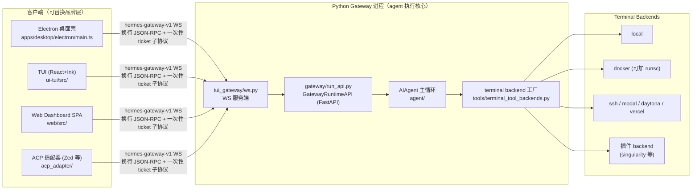
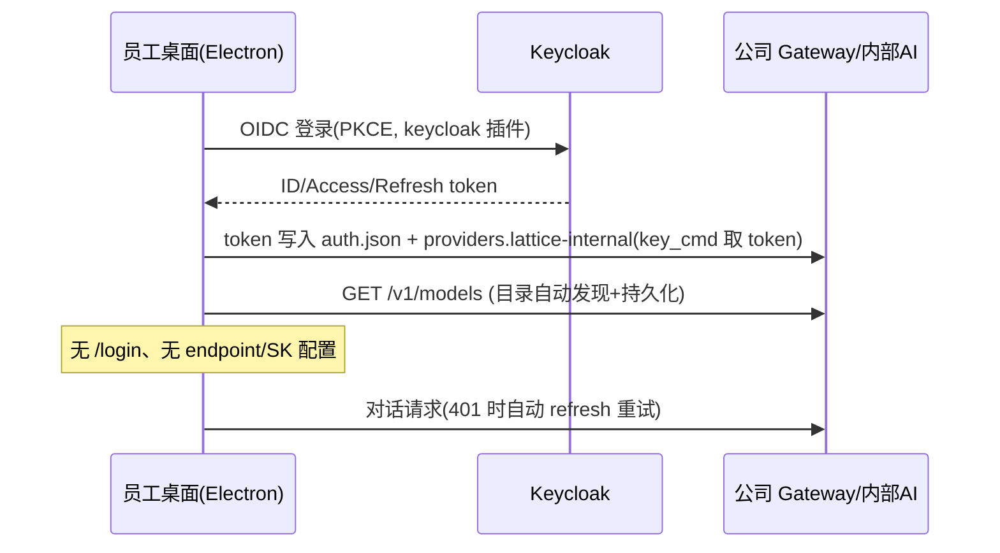

# Hermes Desktop Harness → Lattice Desktop Harness 接入可行性报告

日期：2026-11-13 · 调研对象：`D:/code/hermes-agent-lattice/`（Nous Research hermes-agent，MIT）· 方法：四路并行代码级侦察（桌面壳 / Provider 层 / 沙箱 backend / Skills+认证），全部结论附文件级证据

---

## 1. 总结论

**可行，且 fork 友好度显著高于预期。** 四个后端组件（gVisor、内部 AI、Keycloak、Skill Hub）全部有现成接入点，其中两个是零代码纯配置：

| 组件 | 接入路径 | 代码量 | 风险 |
|---|---|---|---|
| gVisor 沙箱 | Docker backend + `terminal.docker_extra_args: ["--runtime","runsc"]` | **0 行**（纯配置） | 低：容器复用指纹未含 runtime，需 fork 后小修 |
| 内部 AI（OpenAI 兼容网关） | `config.yaml` `providers.<name>` 声明式条目 | **0 行**（纯配置） | 极低 |
| Keycloak SSO | 写一个 `dashboard_auth/keycloak` 插件（照抄现有 nous 插件改端点）+ provider 条目 | ~1 个插件文件 | 低：无现成 Keycloak 代码，但 PKCE/JWKS/RS256 参考实现完整 |
| Skill Hub | GitHub tap（零代码）或发布兼容 `skills-index.json` + URL 配置化小改 | 0 行 或 ~10 行 | 低：唯一障碍是索引 URL 硬编码常量 |

员工体验目标（**Keycloak 登录一次 → 模型自动就绪，无 /login、无 endpoint/SK 配置**）已被 Hermes 的 Nous Portal 流程原生验证过——那套机制（OAuth 登录 → provider/凭证自动写入 → token 自动刷新）只需把 IdP 换成 Keycloak。

法律基础：MIT 协议（`LICENSE`，Copyright 2025 Nous Research），允许修改、再许可、商用、闭源二次开发，唯一义务是副本中保留版权声明。

### 1.1 决策记录（2026-11-13，与狼腾确认）

| # | 决策 | 影响 |
|---|---|---|
| D1 | 更新源必须换成狼腾自建更新源 | CI 固定内部 feed base（等价 `CLOUDFLARE_R2_PUBLIC_URL` 的内部变量），发布链路不依赖 GitHub/Nous（§4、风险#1） |
| D2 | 沙箱分期：初期用默认 local backend（零成本可接受），后续必须支持狼腾自研沙箱 | 初期零改动（local 即默认值）；自研沙箱按 §3.1"深度路径"做成插件 backend，不碰核心代码，不阻塞其他组件 |
| D3 | 全部 logo/品牌元素替换为狼腾自有资产 | 资产替换清单见 §4.1；Windows/macOS 签名身份与全套图标是硬依赖，需提前备妥 |
| D4 | 更新与仓库源：上传/下载/更新源全部改指狼腾自有仓库或内网 IDSB；初期可降级为"提示手动下载"（2026-11-13 确认） | D1 的落地形态。注意：即使手动分发，构建仍须设置内部 feed base 或显式关闭自动更新检查——否则已装客户端的 `app-update.yml` 会回落检查上游 GitHub feed（风险#1） |
| D5 | 登录与模型自动化（**2026-11-13 终版：初期不接 Keycloak**）：初期 login 贴 SK + 中转站 URL/模型全预配（直连模式）；SSO 为第二模式后续开启（§3.2 双模式表） | 直连：`base_url: https://ai.langtonphotonics.com/v1` 预配 + `sk-...` 一次贴入 + `/v1/models` 自动发现；SSO：self_hosted OIDC 已实弹验证（§3.3） |

**初期范围（2026-11-13 狼腾确认）：先做少、做透，只聚焦三件事**——① **界面更新**：剥离上游 Nous/Hermes 可见品牌，呈现中性"公司 private harness"外观（**不引入狼腾专属品牌元素**：图标走抽象晶格方向 A/B，候选 C 晶格狼弃用）；② **登录与模型自动化**（D5）；③ **更新源内部化**（D4）。资产全量替换收窄为界面可见项，DMG/macOS、沙箱、Skill Hub 等全部后移。

---

## 2. Hermes Desktop Harness 架构速览



关键架构事实：

1. **桌面壳是纯壳**。Electron 主进程只做窗口/更新/连接管理，agent 执行全在 Python gateway 进程。协议是自描述的换行分隔 JSON-RPC over WS（`hermes-gateway-v1`），认证用一次性 control ticket 通过 WS 子协议传递，绝不出现在 URL（`hermes_cli/web_server_boundary.py:156-163`）。
2. **三种部署形态原生支持**：每个 connection profile 可配 `mode: local|remote|cloud|ssh`（`apps/desktop/electron/connection-config.ts`）。狼腾可选"员工本机跑 agent + 本地 gVisor 沙箱"或"公司托管 gateway、桌面当瘦客户端"，均无需改协议。
3. **更新机制企业就绪**：Electron + electron-updater，feed 地址从配置读取（`apps/desktop/electron/updater/feed-config.ts` 的 `readUpdatesFeedBaseFromConfig`；用户级 `updates.desktop_feed_base_url`），支持 generic provider 自托管发布（`channel-build-version.test.ts:306`）、stable/canary 渠道、Windows MSIX/App Installer、更新锁与中断恢复，甚至支持 desktop 远程管理 SSH 机器上的安装（fleet 托管更新，`managed-ssh-update.ts`）。
4. **遥测全部 opt-in 且走本地 gateway RPC**，无 PostHog/Sentry 类第三方 SDK——fork 后无外发隐私顾虑 [INFER：基于 scout 的全量 grep]。
5. **中文本地化已有完整基础**：`locales/zh.yaml`（254KB）、`zh.tui.yaml`（93.5KB）。
6. **上游对 gVisor 零感知**：全仓 grep `gvisor|runsc|kata` 无命中——是干净的外部接入点，无隐藏耦合。

---

## 3. 四个后端组件接入评估

### 3.1 沙箱——初期 local，后续狼腾自研沙箱插件化

> **决策 D2**：初期直接用默认 local backend（`terminal.backend: local`，零改动；SECURITY.md 自述 local 无隔离，命令审批层建议保持 manual/smart 模式兜底）。后续狼腾自研沙箱按"深度路径"实现为插件 backend；若自研沙箱本质是 gVisor/runsc 封装，可先用下面的快速路径过渡。

**接入点**：terminal backend 抽象。核心 ABC 是 `tools/environments/base.py:BaseEnvironment`（子类只需实现 `_run_bash` + `cleanup`，基类统一提供 `execute()` 的会话快照/CWD/超时/中断）。工厂在 `tools/terminal_tool_backends.py:_ENV_BUILDERS`（local/docker/ssh/modal/daytona/vercel_sandbox 六种内置 + 插件注册表）。

**快速路径（runsc 过渡选项，P2 备选）**：Docker backend 透传用户参数，`docker_extra_args` 排在 argv 最后可覆盖默认值（`tools/environments/docker.py:741-744`），且校验逻辑无 runtime 白名单（仅 `docker.py:804-811` 检查 env 冲突与 `--network`/`--shm-size` 冲突）：

```yaml
terminal:
  backend: docker
  docker_extra_args: ["--runtime", "runsc"]
```

前提仅是宿主 Docker daemon 注册了 runsc runtime。Hermes 侧零代码改动。

**需注意的一点**：容器复用指纹 `_reuse_environment_fingerprint`（`docker.py:732-735`）可能未包含 extra_args [INFER，scout 未逐行核对]——fork 后应把 runtime 纳入指纹或变更时强制新容器，避免 runsc 切换后复用旧 runc 容器。

**深度路径**（可选）：写 `TerminalEnvironmentProvider` 插件（接口文档齐全：`website/docs/developer-guide/terminal-environment-plugin.md`），绕开 Docker daemon 直接管 rootless runsc；或在 fork 里加第 7 种内建 backend（`_ENV_BUILDERS` 一处表项 + `tools/environments/gvisor.py`）。

**安全语义对齐**：SECURITY.md 自述"agent 进程内的任何机制都不构成边界"（§61-65），官方 posture 就是靠 terminal-backend 隔离或 whole-process wrapper。gVisor 补的正是内核级真边界。另注意 Hermes 自带出口凭据代理（`docker_egress.py`：容器拿 proxy token 而非真实 API key），与 gVisor 正交可叠加。

### 3.2 内部 AI 解决方案——零代码接入

**接入点**：声明式 `ProviderProfile`（`providers/base.py`）+ 注册表（`providers/__init__.py:register_provider`）。custom OpenAI 兼容端点是三层配置面里最简的一层：

```yaml
providers:
  lattice-internal:
    base_url: https://ai.internal.langteng.cn/v1
    key_cmd: lattice-token-cli print-token   # 动态取 Keycloak token
    models: [...]                             # 或留空靠 /models 自动发现
```

- 模型目录：默认 `GET {base_url}/models` 探测（`providers/base.py` 的 `fetch_models`），结果自动持久化回 `providers.<name>.models`（`hermes_cli/model_setup_flows_custom.py:282-285`）——**"模型自动更新"由目录探测天然满足**。
- Keycloak token 注入三层可选（`hermes_cli/config_providers.py:114-123`）：
  1. 静态 `extra_headers`（client 级，主链路/aux/Anthropic 兼容端点全覆盖：`agent/agent_init.py:859-887` 等）；
  2. **`key_cmd` 动态取 token**——运行时执行外部命令，会话中途可重铸，`agent/command_token_source.py` 文档明说面向 "SSO/OIDC brokers"，接 Keycloak 最简路径；
  3. per-request hook：薄 `ProviderProfile` 子类覆写 `request_headers()`（`base.py:563-566`，注入到每请求 `extra_headers`，`agent/turn_api_request.py:37-46`）+ `refresh_runtime_credentials(reason="unauthorized")`（401 自动换发，`base.py:677`）——放在 `$HERMES_HOME/plugins/model-providers/`，零核心改动。
- 内部多模态服务（图像/视频/TTS/搜索）：各能力域有独立注册表（`agent/provider_registry.py` + `web_search_registry.py` / `video_gen_registry.py` 等），实现基类 + `register()` 即可，与 LLM provider 完全解耦。

**中转站定案（2026-11-13）**：**新加坡 LiteLLM**，员工入口 `https://ai.langtonphotonics.com/v1`（nginx 反代，v1.105.1；上游**谷歌 Gemini**，AI Studio `generativelanguage.googleapis.com` 直连；22 个 chat/embedding/image 模型；virtual key + 每把预算 + TPM/RPM + 成本记账；公司 VPN/内网可达——**Workbuddy 直连的就是它**，本工作站当前不在 VPN 故本机探测 000，机器人工作站实测在线）。落地配置：

```yaml
providers:
  lattice-internal:
    base_url: https://ai.langtonphotonics.com/v1
    # key 两种来源，见下方双模式决策；初期 login 贴 SK
    # models: []          # 留空 → GET /v1/models 自动发现并持久化（22 个 Gemini 模型自动就位）
```

注：`http://litellm.internal` 是 staging 集群内另一个 LiteLLM（Lumi 后端用），与员工入口 `ai.langtonphotonics.com` 分开，勿混。

**"模型发布与更新"语义对齐**：中转站（LiteLLM 配置层）增删模型 → 员工端 `providers.lattice-internal.models` 经 `/v1/models` 目录探测自动同步（`fetch_models` + 持久化），**发布 = 改 LiteLLM 配置，客户端零操作**。LiteLLM 侧按团队/Keycloak 角色 Mapping 不同模型组即可做到按角色下发。

**SK 双模式决策（2026-11-13 狼腾确认，最终）**：初期**不接 Keycloak**，login 贴 SK；中转站 URL 与模型全部预配。两种模式共存于同一条 provider 配置：

| 模式 | 时机 | key 来源 | 员工动作 |
|---|---|---|---|
| **1. 直连（初期上线）** | P0 | virtual key 手工分配（现状：OpenCode 自动开通方案 `OpenCode-Go-Teams-LiteLLM-自动化开通架构方案` 尚未接入，key 分发靠管理员） | login 贴一次 `sk-...`；模型/URL 零配置 |
| **2. SSO（后续）** | P1+ | `key_cmd: lattice-token`（自动换取/缓存；依赖 key 自动分配通道落地，可搭 OpenCode 方案的车） | 登录一次全就绪 |

建议：harness 员工单独发 key（与 Workbuddy 的 key 分开），预算与成本记账天然隔离。~~「LiteLLM OIDC 验 JWT」~~ 弃用（virtual key 的预算/审计/对账体系为准绳）；~~「Lumi 工单 24 自动 provisioning」~~ 为目标态但未实现（needs-triage），不作为初期依赖。

### 3.3 Keycloak SSO——**零代码：self_hosted 通用 OIDC 插件 + 配置**（2026-11-13 实弹验证）

**比原判断（"照抄 nous 插件"）更省：`plugins/dashboard_auth/self_hosted/` 就是 discovery 驱动的通用 OIDC 提供方**（authorization-code + PKCE S256、RS256/ES256 JWKS 验签、RFC7009 登出、public/confidential client 自适应），Keycloak 是标准 OIDC——直接配置接入，无新增代码。

**已对真实 realm 完成实弹冒烟**（`sso-staging.langtonphotonics.com/realms/langteng`）：

- OIDC discovery 解析 ✓（authorization/token/jwks/revocation 端点齐全，revocation 端点 Keycloak 原生提供）
- `SelfHostedOIDCProvider` 构造 + `start_login` 实测 ✓：authorize URL 正确生成（`response_type=code` + PKCE S256 + state + `redirect_uri` 强制 `/auth/callback` 结尾）
- realm **已启用 device_code grant**（discovery `grant_types_supported` 实证，原 [INFER] 消除）——CLI device-code 流可直接用
- `token_endpoint_auth_methods` 含 `client_secret_basic/post`——public（纯 PKCE）或 confidential 两种客户端形态都支持

**落地配置（config.yaml，等 3 个参数即可启用）**：

```yaml
dashboard:
  oauth:
    self_hosted:
      issuer: https://sso-staging.langtonphotonics.com/realms/langteng   # 生产切正式 realm
      client_id: lattice-dashboard     # ← 待建：Keycloak 客户端（见下方规格）
      # client_secret: ...             # confidential 客户端才需要；public+PKCE 留空
```

**Keycloak 侧需建的客户端规格**（realm `langteng`，管理台几分钟的事）：

| 项 | 值 |
|---|---|
| Client ID | `lattice-dashboard` |
| 流程 | Standard Flow（authorization-code）；**Public 客户端 + PKCE S256 强制**（无 secret，桌面分发最简） |
| Valid Redirect URIs | `http://localhost:*/auth/callback`、`http://127.0.0.1:*/auth/callback`（本机 gateway）+ 托管部署的实际 origin `/auth/callback` |
| Scopes | `openid profile email`（默认即可；如需角色再开 `roles`） |

**覆盖面自动扩展**：桌面 app 复用 dashboard OAuth 会话（`cloud-session-recovery.ts`、cookie + 单次 ticket）；WS 走 `/api/auth/ws/ticket` 铸 30 秒单次 ticket，`auth_identity` 盖进 transport（`tui_gateway/ws.py:144-152`）——**provider 注册后 web/desktop/TUI 全链路 SSO 自动生效**。

**CLI 推理面**：device-code 流已全参数化（`hermes_cli/auth.py:148-176` `PROVIDER_REGISTRY`），realm 已实证支持 device grant；或声明式 `auth_oauth_pkce_plugin.py`（confidential client 场景）。模型请求侧 token 由 §3.2 的 `key_cmd`/`request_headers` 承接。

**⏳ 阻塞项（需狼腾提供）**：① 在 realm 建上述客户端（或给权限我来建）；② 中转站**员工机可达**的 base_url——`litellm.internal` 是集群内 DNS（工作站不可解析），候选 `api.langtonphotonics.com` 本机也不可达，需确认员工网络内的实际地址；③ 决定网关鉴权形态（静态 key 起步 / 直接透传 Keycloak token——LiteLLM 原生支持 OAuth2/OIDC master key）。

**"登录一次全部就绪"的落地链路**（对应员工零配置诉求）：



**缺失项**：仓库无任何 keycloak/标准 OIDC discovery 代码（全仓 grep 证实）；远程多用户部署需强制打开 dashboard auth gate（非 loopback 绑定 `HERMES_DASHBOARD_PUBLIC_URL` 时已自动触发，`config_defaults.py:1043-1047`）。

### 3.4 SkillHub 接入与安装管控——**格式层即插即用，管控层小改可锁死**（2026-11-13 更新）

**狼腾 SkillHub 已是生产级服务**（`lumi-ai/.local-run/skillhub/`：server + scanner 容器栈、独立 PostgreSQL `skillhub` 库、Redis DB2、Keycloak `skillhub-local` 客户端、镜像锁定/备份/迁移齐备；后端含 `lumiai/skill_market.py`、`skill_review.py`（**上架审核流已有**）、`skillhub_import.py`）。skill 格式就是 agentskills.io 标准 `SKILL.md`（YAML frontmatter），且自带 `metadata.officeplus` 扩展：版本、中文标题/描述/引导、分类、图标、`defaultInstall` 标志——**`defaultInstall` 天然就是「员工默认装什么」的管控位**。Hermes 侧只读 `name/description`，扩展字段无害透传。

**接入路径（正式路径，弃 GitHub tap——你们 hub 是 API 服务不是仓库）**：
1. SkillHub 暴露一个 `skills-index.json` 兼容端点（`{"skills": [...]}`，缓存协议已有样例 `skills/index-cache/`；hub 侧薄适配层）；
2. fork 把硬编码 `HERMES_INDEX_URL`（`tools/skills_hub_search.py:27`，指向 nousresearch.com）改为配置 `skills.hub.index_url`（约 10 行）；
3. 放行 hub 域名过 SSRF/website-policy 拦截（`tools/url_safety.py` + `website_policy`，skills_hub 的每次 GET 都走策略检查 `skills_hub.py:116-230`）——报告风险#4。

**「管理员工装哪些」的管控栈**（四层，全部有现成机制）：

| 层 | 机制 | 落点 |
|---|---|---|
| 目录治理 | 员工可见 = SkillHub 上架的（审核流已有） | hub 侧：`skill_review.py` |
| 安装源锁死 | fork 配置化后关公共源（`create_source_router` 的 github/skills-sh/clawhub 等适配器 + taps），且用 **config lock**（`hermes_cli/config.py` 锁机制，任意 config path 可锁）把 `skills.hub` 锁在 global 级，员工改不了 | fork：`skills_hub_search.py:99` 路由裁剪 + lock |
| 默认下发 | `defaultInstall: true` 的 skill 预装（打包时入 fork `skills/` 目录或首启预装） | fork 打包脚本 |
| 审计与回收 | 安装即 provenance 锁 + 审计日志（`skills_hub.py:374-450`）；hub 下架后卸载走标准更新流 | 已内建 |

**插件（plugins）**：另一套机制（`plugins/` + plugin-catalog），fork 把默认插件 catalog 指内部（§4 清单 `desktop-plugin-install.ts` 行）——初期不急，skills 先行。

---

## 4. 品牌化 Lattice 改造清单

| 项 | 位置 | 工作量 |
|---|---|---|
| 产品名/appId/MSIX/publisher/cli 名 | `apps/desktop/product-identity.cjs`（单一来源）+ `electron/product-identity.ts` | 一处集中改 |
| 安装器品牌 | `apps/bootstrap-installer/src-tauri/tauri.conf.json` + `src/components/brand-mark.tsx` + icons | 一份配置 |
| 打包图标/协议 scheme | `apps/desktop/electron-builder.config.cjs`（productName/icon/protocols `hermes://`） | 一处 |
| Nous 域名清理（~10 处散点） | `portal-session.ts:29`（portal URL，env 可覆盖）、`hub-iframe-policy.ts:15-17`、`hermes-cloud.ts`（`.agents.nousresearch.com` 后缀）、`backend-health.ts:153-157`、`desktop-plugin-install.ts`（默认插件 repo）、`bootstrap-runner.ts:232`（GitHub raw 安装脚本）、`updater/system-proxy-env.ts:36`（更新 host 白名单） | 半天级排查替换 |
| **更新源回落坑** | electron-builder publish 无 `CLOUDFLARE_R2_PUBLIC_URL` 时默认回落 **GitHub NousResearch repo**（`electron-builder.config.cjs:52`）——fork 必须显式设置内部 feed | 必改项 |
| WS 子协议/header 名 | `hermes-gateway-v1`、`x-hermes-*` header（`web_server_boundary.py:156-157`）——对外可见品牌字符串 | 可选 |
| TUI/Web 文案 | `ui-tui/src/i18n/`、`web/src/themes/`、`resolve-page-title.ts` | 可选 |

**自动发布流水线**：CI 设置内部 feed base（`update-feed.cjs` 接受任意 https base）→ electron-updater generic provider 拉取 `<base>/releases/<platform>/<channel>/`；渠道体系 stable/canary 现成；Windows 走 MSIX + App Installer 源。公司侧只需一个静态文件服务器 + CI 发布产物。

**更新源的三个层面（决策 D1 全景）**：桌面壳 feed（electron-updater generic provider，feed base 由 CI 变量 `CLOUDFLARE_R2_PUBLIC_URL` 注入，`update-feed.cjs:25-38` 强制 canonical https，缺失时 electron-builder 回落 GitHub Nous repo——`electron-builder.config.cjs:60`）之外还有两处下载源需要内部化：

1. **PM 工具库**：运行时从 GitHub releases 下载 uv/ripgrep/FFmpeg/git/gh 等工具二进制（`pm/packages.py` 各 `fetch_url`，pin 在 `pm/lock.json`）。好消息是已有镜像机制——`pm/artifact-mirror.json`（`{"origin": ..., "prefix": "upstream/sha256/"}`，当前指向 `hermes-assets.nousresearch.com`），fork 后把 origin 指向狼腾内部静态镜像即可整体接管。
2. **Bootstrap 安装脚本**：`apps/desktop/electron/bootstrap-runner.ts:232` 从 GitHub raw 拉安装脚本，需指向内部源或改用预装 MSIX。

### 4.1 Logo/资产替换清单（决策 D3）

| 资产组 | 位置 | 内容 |
|---|---|---|
| 桌面应用图标全尺寸集 | `apps/desktop/assets/` | `icon.ico` / `icon.icns` / `icon.png` / `icon-dark.*` / `icon-mac.png` + MSIX `appx/` 60+ 张各尺寸 logo + `icon.icon/`（macOS 图标源，含 `icon.json`） |
| 安装器图标 | `apps/bootstrap-installer/src-tauri/icons/` | `icon.ico` / `icon.icns` / `128x128.png` / `128x128@2x.png` / `32x32.png` + `icon.icon/` |
| 渲染器内置品牌素材 | `apps/desktop/public/` | `nous-girl.png`、`nous-girl-dark.png`、`hermes.png`(1.3MB)、`hermes-sprite.png`、`hermes-frames/` 8 帧动画（onboarding 素材）、`apple-touch-icon.png`、`ds-assets/` |
| 图标母版/DMG/横幅 | `assets/`（repo 根） | `icon-master.svg` / `icon-master-dark.svg`（矢量源）、`nous-girl-white/black.svg`、`dmg-volume.png`（macOS 安装卷背景）、`banner.png`、`backgrounds/squircle-*.svg` |
| 安装器 UI 品牌组件 | `apps/bootstrap-installer/src/components/brand-mark.tsx` | 安装器内 logo 渲染逻辑 |
| 文档站资产 | `website/static/img/` | `nous-logo*`、`logo*`、`favicon*`、banner（若保留文档站则一并替换） |

**硬依赖提醒**：图标替换不是纯美术活——MSIX 的 publisher 必须与代码签名证书主体一致（`scripts/msix-shared.mjs` 的 `OUT_OF_STORE_PUBLISHER` + `product-identity.cjs`），macOS 分发需 Apple Developer ID 签名身份（`apps/desktop/scripts/mac-sign.mjs`）。狼腾需提前备妥：Windows 代码签名证书、Developer ID（如发 mac）、全套尺寸的狼腾图标源文件（最大到 `icon.icon` 的 macOS 全规格）。
### 4.2 首批生成资产（2026-11-13，Higgsfield Nano Banana 2 无限模式）

概念稿已生成并下载到 `assets/lattice-concepts/`（提示词以 `LATTICE-ASSET-20261113-*` 为前缀，可在 Higgsfield 生成历史按前缀复核）：

| 文件 | 规格 | 用途（对应 §4.1 资产组） |
|---|---|---|
| `mascot-hero-dark.png` | 2752×1536 RGB | onboarding 深色主视觉（`nous-girl-dark.png` 替换源） |
| `mascot-hero-light.png`（带参考图） | 2048×2048 RGB | onboarding 浅色主视觉（`nous-girl.png` 替换源） |
| `mascot-hero-light-noref.png`（无参考图对照） | 2048×2048 RGB | 同上；与带参考版对比身份漂移后弃用一方 |
| `icon-a-lattice-cube-light.png` | 2048×2048 RGB | 图标母版候选 A：晶格立方·浅底 |
| `icon-b-lattice-cube-dark.png` | 2048×2048 RGB | 图标母版候选 B：晶格立方·深底 |
| `icon-c-lattice-wolf.png` | 2048×2048 RGB | 图标母版候选 C：晶格狼——**已弃用**（初期定为中性外观，不引入狼腾元素） |

**图标结论（2026-11-13 核实）：Lumi AI（IDSP）已有同款正式图标，直接复用**——`D:/code/lumi-ai/desktop/assets/icon.svg`（"Photonics crystal lattice application icon"：藏蓝 `#163C84` 圆角瓷砖 + 等距晶格立方 + 珍珠白棱线 `#F5F8FE` + 金色顶点/光轨 `#FCAE18`），且自带派生管线 `desktop/scripts/render_icons.cjs`（SVG → 512 PNG / 32/64 托盘 / Windows ICO，产物入库）。本报告候选 A/B 与之撞型但配色偏离（青色系），**全部降为备选**；Lattice harness 图标采用 Lumi 既有体系，与公司工具家族保持一致。

吉祥物身份沿用表单中已锁定的 Baize 描述（pale-blue hood / 黑面罩 / 双青色眼标），带参考图生成，与既有 LUMIAI 系列同源。

浅/深主视觉比例暂不一致（dark 16:9、light 1:1，因提交时比例设置不同）——定稿前统一（重生成 dark 为 1:1 或裁切）。

**派生管线（母版 → 全尺寸集，概念稿选定后执行）**：
1. 图标：**复用 `lumi-ai/desktop/assets/icon.svg` 母版**（配色金+藏蓝，勿改回青色系）→ 扩展 `render_icons.cjs` 同款流程派生 Hermes 侧全套：`icon.ico`（16–256）/ `icon.icns` / MSIX `appx/` 60+ 张 / `icon.icon` 源 / 安装器 `bootstrap-installer/src-tauri/icons/`；深浅模式共用藏蓝瓷砖底（两种背景下均可读，无需 `icon-dark.*` 双版）。
2. 吉祥物：**优先复用 `lumi-ai/lumi-mascot/frontend/` 矢量体系**——`baize.svg` 直接渲染 256×256 RGBA 替换 `nous-girl*.png`（矢量直出，优于 AI 栅格+抠图）；`hermes-frames/` 8 帧动画从 `baize-motion.svg`（配 `baize-motion.json`）或 `lumi-baize-v1.riv` 导帧；深色版由 SVG 换色再渲。本报告生成的 mascot-hero 光/暗图改定位为 onboarding 场景插画（吉祥物+晶格立方同框的成品图，矢量包里没有这一层），定稿前统一为 1:1 或裁切。
3. 横幅/DMG 背景：延后——DMG 依赖 macOS 范围决策（见 §6）。

**已知缺口**：生成图为 RGB 无 alpha，直接替换 RGBA 精灵需抠图；全部概念稿需人工目检（身份一致性/表情/无文字残留）。

---

## 5. 风险与缺失项汇总

| # | 风险/缺失 | 等级 | 缓解 |
|---|---|---|---|
| 1 | electron-builder publish 默认回落 Nous GitHub——不显式配置会把员工更新指向上游 | **高（必改）** | CI 固定设置内部 feed base；发布前验证 update feed JSON |
| 2 | gVisor 切换后容器复用指纹可能不含 runtime [INFER] | 中 | fork 后把 extra_args 纳入 `_reuse_environment_fingerprint`；跑 `docker/sandbox-desktop-smoke.sh` 类冒烟 |
| 3 | SSO 模式的 Keycloak 侧配置（客户端/redirect/PKCE） | 低（**已消解大半**） | `self_hosted` 通用 OIDC 插件实弹验证通过（discovery/PKCE/device grant 全 ✓）；客户端规格与向导路径已踩通（§3.3），P1 建客户端即可 |
| 4 | Skill hub 索引 URL 硬编码，且 SSRF 防护默认拦私网域名 | 中 | URL 配置化 + 内网域名白名单 |
| 5 | 上游演进速度（repo 活跃，12 个 i18n、大量近期提交）——长期跟随上游的合并成本 | 中 | 锁定 tag 基线，仅把改动收敛在插件 + 配置 + product-identity，最小化 core diff |
| 6 | 强制更新策略（禁止员工停留旧版）机制未内建 | 低 | 渠道 + fleet 托管更新已有；策略层在内部 feed 网关上做（停发旧 channel 即可推动） |
| 7 | bootstrap 安装器从 GitHub raw 拉脚本（`bootstrap-runner.ts:232`） | 低 | fork 后指向内部源或预装 MSIX |

---

## 6. 建议路线图

**P0（1–2 周，界面先行 + 直连上线）**：**① 界面去品牌化**：`product-identity.cjs` 改中性产品名 + §4 的 Nous 域名/文案半日清理 + 图标复用 Lumi 母版派生全套 + onboarding 主视觉替换（§4.2）→ **② 更新源内部化（D1/D4）**：CI 固定内部 feed base 指自有仓库/IDSB。若 IDSB 暂不能托管 feed（需 canonical https + `.appinstaller`/MSIX 正确 MIME），可先经 IDSB 手动分发 MSIX 并提示下载，但**必须同时禁用/改写更新检查**防回落上游 GitHub → **③ 模型直连（SK 双模式之直连，§3.2）**：预配 `providers.lattice-internal`（`base_url: https://ai.langtonphotonics.com/v1`，models 留空自动发现），员工 login 贴一次 SK（virtual key 手工分配，建议 harness 专用 key）。**不接 Keycloak**。沙箱保持默认 local backend（D2，零改动）。

### 6.1 P0 实施进展（2026-11-13 开发实录，代码在 `D:/code/hermes-agent-lattice`）

| 项 | 状态 | 证据 |
|---|---|---|
| 产品身份中性化 | ✅ 完成 | `apps/desktop/product-identity.cjs`：variants → Lattice / Lattice Light / Lattice Agent（kebab `lattice[-light|-bundled]`）；`appId` → `com.langtonphotonics.*`；MSIX org → `LangtengPhotonics.*`；cliName 保持上游语义（light 专属名、其余基础名 `lattice`）；`hermes://` 协议与 Store 块按决策不动。`product-identity.test.ts` 契约表同步，vitest **10/10 通过** |
| 模型直连预配 | ✅ 完成 | `hermes_cli/config_defaults.py` `DEFAULT_CONFIG.providers.lattice-internal`：`base_url` + `key_env: HERMES_CUSTOM_LATTICE_INTERNAL_API_KEY`（官方 `custom_endpoint_key_env` 槽位，SK 落 `~/.hermes/.env` 不进 config.yaml）。文档补进 `website/docs/integrations/providers.md`（含 yaml 示例），`tests/ci/test_docs_drift.py` **2/2 通过** |
| 图标全量换 Lumi 晶格 | ✅ 完成 | `assets/nous-girl-{black,white}.svg` 替换为 Lumi `icon.svg` 晶格的单 path 正形重 ground（navy `#163C84` 光面版 / 珍珠白 `#F5F8FE` 深面版）；适配管线硬契约（单 `<path>`、绝对 M/L/C、无 transform、alpha-bbox）。`scripts/generate_icons.py` fork 调整：`EDGE_OVERSHOOT=0` + `join_bottom` 基准改为注册框底（晶格是几何居中图案，不需要人像发梢贴边注册）。99 产物重生成，`--check` **全过**；像素级验证无透洞、底部安全边 48px、明暗两版对称。BrandMark（`public/nous-girl*.png` 256）自动继承晶格 squircle |
| Nous 域名/文案清理 | 🔶 范围收敛 | renderer 实扫 109 处 Nous 引用，绝大多数在 fork 不用的功能模块（billing/credits、cloud relay、pet 服务）。**P0 只动用户可见面**（已完成：应用名/图标/mark）；i18n 文案 ~250+ 处 "Hermes" 字样（en 217 + boot 31 + 十余语言镜像）留待独立机械清扫步骤（牵连文案断言测试）；`backend-health.ts`/`portal-session.ts` 等 main 进程惰性代码保持上游原样保 rebase |
| 更新源内部化 | ⏳ 待基础设施决策 | 依赖内部 feed 域名/IDSB 托管确认；`bootstrap-runner.ts:232` GitHub raw、`electron-builder.config.cjs:60` 回落、CI feed 变量在落地时一并改 |

验证门禁：identity vitest 10/10 ✓、docs drift 2/2 ✓、icons --check 99/99 ✓、pm testenv（`installs/9c11d54f0a256c33/test-environment`）+ pnpm 12.15.0 工作区依赖就绪。开发环境注意：本机 `bash` 解析到 WSL，跑 `scripts/run_tests.sh` 须用 `"D:/Program Files/Git/bin/bash.exe"` + `HERMES_PYTHON` 指向 testenv venv。

Windows 跑 desktop vitest 另需 `HERMES_PYTHON` 指向 testenv venv（多处测试 `execFileSync(process.env.HERMES_PYTHON || 'python3')`；Windows 无 `python3` 命令）。

### 6.2 Windows 优先验证矩阵（2026-11-13 用户定调：员工全部用 Windows desktop harness）

**原则**：上游 CI 只在 Linux 跑，"测试在 Windows 失败"需区分**测试基建盲区**（上游从未在 Windows 验证过测试脚手架）与**产品缺陷**；前者修复列为 fork 基建任务，后者立即修。

| 项 | 结果 | 定性 |
|---|---|---|
| identity / docs-drift / icons 门禁 | ✅ 全绿（见 6.1） | Windows 上同样通过 |
| `tests/hermes_cli/test_config.py` 171 过 / 2 败 | 🔶 预存 | `TestEnvWriteDenylist` 两例按 POSIX 大小写语义断言（小写 `ld_preload` 近似名应可写）；Windows `.env` 写入器大小写不敏感匹配 denylist 拒绝（更严更安全）。对员工贴 SK 无影响（`HERMES_CUSTOM_LATTICE_INTERNAL_API_KEY` 不涉 denylist）。上游测试需 `platforms` 标记或双语义适配 |
| `channel-build-version.test.ts` | ✅ 已修绿（4/4） | Windows 盲区两处：① `record()` 的 `os.name=="nt"` 分支要 `*-unpacked/<exe>`——测试夹具补 `version-info-x64.json` sidecar 绕开；② 默认 20s 超时不足（Windows spawn 慢 4-8 倍）→ 180s。跑时需 `HERMES_PYTHON` 指向 testenv（测试 spawn `python3`，Windows 无此命令） |
| `commit-bundles.windows.test.mjs` | ✅ 已修绿（1/1） | Windows-only 测试（CI Linux skip，上游从未验证）：沙盒复制清单漂移——`windows-bundle-tools.mjs` 新依赖 `prepared-packaging.mjs` 未入清单，补一行复制。此测试真跑 makeappx 组装 msixbundle，是 Windows 打包链的活体验证 |
| `checkout-source.test.ts` / `updater/channel.test.ts` | ✅ 通过 | 此前的失败是并发跑测试时临时 shell PATH 假象 |
| `pnpm run pack`（--dir unpacked Windows 打包链） | ✅ 打通（83s，镜像补工具链后） | `release/win-unpacked/Lattice.exe`：exe 名/ProductName/FileDescription=Lattice；asar 完整性+18 PE 扫描+after-pack backend 就绪校验全过；未签名（证书未采购，AZURE_SIGN 未设） |

### 6.3 首次实机反馈修复（2026-11-13，用户指出：窗口仍显示 Hermes、图标不对）

用户看到的窗口是标题修复**之前**的打包产物；排查后补齐的残留源（全部改掉）：

| 残留源 | 位置 | 修复 |
|---|---|---|
| 原生窗口标题 ×4 | `electron/main.ts`（BrowserWindow `title:'Hermes'` 四处） | → `'Lattice'` |
| 渲染层 HUD 标题 | `src/main.tsx:67` `document.title='Hermes HUD'` | → `'Lattice HUD'` |
| HTML title | `index.html` `<title>Hermes</title>` | → `Lattice` |
| 托盘 tooltip | `electron/minimize-to-tray.ts:186` | → `'Lattice'` |
| 通知标题回退 ×2 | `notification-ipc.ts:64`、`notification-linux.ts:253` | → `'Lattice'` |
| 终端标识 | `terminal-ipc.ts:195` `TERM_PROGRAM='Hermes'` | → `'Lattice'` |
| 应用名回退 | `main.ts:1398` `APP_NAME || 'Hermes'` | → `'Lattice'`（运行时本就优先走 identity=Lattice，此为缺失回退） |
| exe CompanyName | `package.json` author `'Nous Research'` | → `'Langteng Photonics'`（重打后 exe 属性 ProductName/FileDescription/CompanyName = Lattice/Lattice/Langteng Photonics 已实证） |
| publisherDisplayName | `electron-builder.config.cjs:253`（MSIX 非商店发行显示名） | → `'Langteng Photonics'` |

**i18n 全语言文案清扫**：`src/i18n/` 全部语言文件 `Hermes→Lattice`、`Hermes Cloud→Lattice Cloud`、CLI 命令示例 `hermes→lattice`；保护 `~/.hermes`、`.hermes/` 路径、`hermes://` 协议、`hermes-agent.nousresearch.com` 域名、`HERMES_` 前缀。2498 行替换，diff 审计无品牌词外改动；i18n 自身测试 85/85 通过。教训：sed 曾误伤 `@hermes/shared/i18n` import 别名（已回滚）——清扫必须保护 `@hermes/` 包别名。

图标链实证（用户"图标不对"的判定依据）：exe 图标经 `[set-exe-identity] assets/icon.ico` stamped（晶格 ico），窗口/托盘图标走 `getAppIconPath()`→resources/icon.ico（同一 ico）。若实机仍见旧图，优先怀疑 **Windows 图标缓存**（旧 Hermes 安装的缓存项），处置：`ie4uinit.exe -show` 刷新或删 `%LOCALAPPDATA%\IconCache.db` 后重启 explorer。

### 6.4 狼腾品牌化切换（2026-11-13 用户指令：参考官网 wolf.trisanet.com 与 langtong-frappe 素材，推翻此前"中性外观"决策 D3）

**品牌素材实证**：
- 官网（登录后抓取）：logo `logo-54b50cf5.png` 440×182 实测主色 **#0C3C84 深蓝 + #FCA818 金**；登录页按钮 #021132、ring #163C84——与 Lumi icon.svg 色系同源（同企业色）。
- `langtong-frappe/deploy/brand/lt-icon.svg`（内嵌 256 位图，实测 #0C3078/#FCFCFC/#F0A818）：**官方 icon = 深蓝底 + 白色 LT 字母 + 金色弧线**。
- `docs/prototypes_legacy_review/lattice-app-icon.svg` 为已废弃原型（青紫渐变，偏离品牌色，未采用）。

**图标实现**（保管线零改动）：squircle 背景改品牌蓝（light `#0C3C84` / dark `#021132`，mac 版同步，`DARK_HEX` 跟随）+ 金弧 swoosh 放进背景 SVG（背景可任意 stroke）+ girl art 换单 path LT 字母正形（白色，绝对 M/L/Z，`GIRL_BOXES` 高度 872.8→850 使底距 71px 与左右均衡，弧-字间距 56px）。99 产物重生成 `--check` 全过，视觉模型判定 ship-ready。之前生成的 Lumi 晶格图标被本方案**替换**（用户指令优先）。

**交付产物**：`apps/desktop/release/win-unpacked/Lattice.exe`（窗口标题 [Lattice]、exe 属性 Lattice/Langteng Photonics、任务栏/托盘图标 = LT 金弧品牌 icon、无 Hermes 品牌残留——启动 4 进程存活 + 截图视觉确认）。未签名（证书采购前）；员工模型端点 `lattice-internal` 已预配。

### 6.5 发布下载存储方案（2026-11-13 用户定向：优先复用 PDS bucket）

**推荐：存储复用 PDS bucket，发布面走公司 nginx 反代**（与 ai.langtonphotonics.com 同款部署），理由：

| 判据 | 结论 |
|---|---|
| electron-updater 硬约束 | `update-feed.cjs` 强制 **canonical https**；feed 文件需稳定 URL + 正确 MIME（`latest.yml` text、`.msix` octet-stream、`.appinstaller` application/xml） |
| PDS 直连风险 | 若 PDS 走签名/临时 URL（302）或网盘分享页形态，canonical 校验与 MIME 不可控——**不能裸直连做 feed** |
| nginx 反代解法 | 现有 nginx（SSL 证书/域名/内网可达全现成）加一条 location（如 `https://<dl域名或 ai 域名>/lattice-feed/`）代理 PDS bucket 并由 nginx 定 MIME + 长缓存 → **存储复用 + 发布面合规**两头满足 |
| 单独 OSS P bucket | 仅当 PDS 出现带宽/签名/生命周期限制时再开；OSS 新 bucket 成本虽低，但多一套权限/密钥/账单面，初期无必要 |

落地三步：① PDS 建 `lattice-harness/` 前缀（按版本子目录 `0.21.x/`）② nginx 加反代 location + MIME 映射 + `Cache-Control` ③ CI 变量 `LATTICE_FEED_BASE_URL` 指向该 https 前缀（`electron-builder.config.cjs` 的 GitHub 回落一并切断）。手动 MSIX 分发初期可先只做 ②+对象直传，feed 待 CI 通了再切。

后续 Windows 门禁（P0 收尾项）：unpacked exe 启动 smoke（应用名 Lattice、托盘/任务栏图标晶格、Settings→Providers 出现 lattice-internal 端点）→ 完整 MSIX（签名证书采购前出未签名包验证 makepri/makeappx 链）。

**P1（2–4 周，SSO 模式 + 发布管道）**：**SSO 模式（SK 双模式之二，§3.3 已实弹验证）**：Keycloak realm 建 `lattice-dashboard` 客户端（向导三步已踩通，等管理台重登即可建）→ `dashboard.oauth.self_hosted` 配置接入 → `key_cmd: lattice-token`（依赖 key 自动分配通道，可搭 OpenCode 开通方案的车）→ 内部 MSIX/App Installer 发布管道（IDSB 或内部 feed）→ 签名证书落地。

**P2（按需，沙箱与生态）**：**狼腾自研沙箱插件 backend（决策 D2"后续"：`TerminalEnvironmentProvider` 实现；若为 gVisor 封装可先走 `docker_extra_args` runsc 快速路径过渡）** → Skill Hub 正式接入（索引兼容层 + URL 配置化 + 私网白名单）→ 强制更新策略层。

---

## 附录：核心证据文件索引

- 架构：`apps/desktop/electron/main.ts`、`local-gateway.ts`、`connection-config.ts`；`tui_gateway/ws.py`、`transport.py`、`session_transports.py`；`gateway/run_api.py`；`ui-tui/CANONICAL_GATEWAY.md`
- 认证：`hermes_cli/dashboard_auth/{base,registry}.py`、`plugins/dashboard_auth/nous/__init__.py`、`hermes_cli/auth.py:148-176`、`auth_device_flow.py`、`auth_oauth_pkce_plugin.py`、`hermes_cli/web_server_boundary.py:156-163`
- Provider：`providers/base.py`（`request_headers`:563、`refresh_runtime_credentials`:677、`create_client`:604）、`providers/__init__.py:register_provider:141`、`hermes_cli/config_providers.py:114-123`、`agent/command_token_source.py`
- 沙箱：`tools/environments/base.py`（ABC）、`docker.py`（`extra_args`:741-744、指纹:732-735、egress:716-737）、`tools/terminal_tool_backends.py:268`、`agent/terminal_env_provider.py`、`SECURITY.md`、`docker/sandbox-desktop.Dockerfile`
- 更新：`apps/desktop/updater/feed-config.ts`、`update-feed.cjs`、`electron-builder.config.cjs:52`、`install-stamp.ts:85`
- Skills：`hermes_cli/agent_plugins.py:283-326`、`tools/skills_hub_search.py:27,99`、`tools/skills_hub.py:468`（taps）、`agent/curator.py`
- 品牌：`apps/desktop/product-identity.cjs`、`apps/bootstrap-installer/src-tauri/tauri.conf.json`
