# 狼腾 Lattice 企业桌面 Harness：代码审查与交付方案

2026-11-13。状态：方案与首个发布工具切片，**尚未达到生产就绪**。
源码基线：本仓库 `c9b20d7bc0`；关联本地快照 lumi-ai `fd016c76`、skillhub `f4bc07ab`、cloud-image `b89125d`。
只读核实源码/文档，没有读取密钥、连接生产或验证现网。关联能力仅对这些快照成立。

## 最新基线更正与素材复用（2026-11-13 晚）

本轮刷新远端后，Hermes fork 最新主线为 `10e03e0097`，门户为 `b75382a`，Lumi AI 为 `2df9570c`。
前述初轮快照不是这些仓库的最新主线；以下更正覆盖旧审查表中的品牌与默认端点现状，不能再把旧目录中的实现当现行版本。

- 当前公司形象是**白泽洁净间机器人**。负责人明确不采用小狼，撤回旧小狼复用建议。
- 最新主线已在欢迎页与首次启动页使用 `apps/desktop/public/mascot/baize.svg`；该文件与 Lumi AI
  `lumi-mascot/frontend/baize.svg` 的 SHA-256 相同：`7d7d3aca14acf217a8d42d70b5ed7317b91f979713922da660bc9be9994618d4`。
  因此不能再报告“尚未复用白泽”。后续验收关注静态欢迎图与真实任务状态动画的差距。
- 最新主线已经修改 Lattice 名称、公司 appId、默认主题，并预置 `providers.lattice-internal` 的 HTTPS LM 地址与密钥槽位。
  这不等于 SSO 设备登录、短期凭据兑换、模型事件推送或企业签名发布已完成；逐项核对实际执行链。
- 每次跨仓库复用先刷新远端 refs，记录分支、commit、包版本和内容摘要；主目录的名称/文件存在不证明版本最新。
  使用独立 worktree，不覆盖其他会话的改动，未合入素材需标明分支来源。

| 可复用项 | 已核实来源 | 接入办法 |
| --- | --- | --- |
| 白泽静态形象 | Lumi AI `2df9570c` 的 `lumi-mascot/frontend/baize.svg`；本项目主线已复用 | 保留同一图形与可追踪摘要，不重新生成角色 |
| 白泽动作、道具与场景 | `@langton/lumi-mascot` `0.1.7`：`baize-motion.svg/json`、`svgMotion.ts`、`contract.ts` | 复用平台无关 SVG/动作引擎，为现有 React 做薄适配；不为消费 Vue SFC 引入第二套应用外壳 |
| 公司 Logo、应用 SVG 与官网风格素材 | 门户 `b75382a` 的 `services/web/src/assets/brand/` | 复用亮/暗 Logo、Lattice/Lumi 图标与经过批准的品牌素材；保留来源，不直接搬整页门户布局 |
| 设计令牌 | langtondesign `94505b0` 的 `tokens.json` / 生成 `tokens.css`；门户 vendor MANIFEST 对齐 `5.0.0` | 版本化消费或带 MANIFEST 的构建期同步，禁止再造颜色/字体令牌源 |
| 图标 | 门户 Lucide 图标体系；桌面已有 `lucide-react` | 优先复用既有图形和线宽规范，保留第三方许可；不以 Emoji 替代产品图标 |

上一轮下载页 `scripts/releases/downloads.css` 仍为独立手写颜色与字体；虽然使用公司配色，尚未满足统一令牌复用要求。
后续应消费同源令牌与本地品牌资源，并重新计算内联 CSS 的 CSP 摘要，不能只改颜色后宣称完成统一主题。
较大设计概念图放素材库/制品服务，运行时只带必要资源，遵守仓库二进制体积门禁。

白泽状态必须由实际 gateway 任务、用户确认和音频事件驱动；等待确认不冒充录音。
复用后台/隐藏暂停、关闭动画、减少动态效果和卸载清理行为，包内加载资源，按公司现有规范验证亮/暗主题及 1440/1280/390 宽度。
官网当前在线版本尚未核验；门户已复用的官网素材可作为已知参考，不宣称已完成线上官网一致性验收。

## 架构决策

Lattice 定位为员工本地执行客户端：复用 Hermes 的会话、调度、工作区、工具和 canonical gateway。
企业控制面管理身份、授权模型目录、能力目录和发布策略。维护小规模发行版差异；业务集成用既有 provider、MCP、skill、独立 plugin seam，不增加默认 core tools。
Electron 管本机凭据与生命周期，renderer 管交互，gateway 管执行。Lumi HTTP API 不能冒充 Hermes JSON-RPC gateway。

```mermaid
flowchart LR
    Portal[LDSP / IDSP] --> Downloads[统一下载中心]
    Web[Lumi AI 网页] --> Downloads
    Downloads --> Artifacts[不可变版本制品库]
    Desktop[Lattice / Electron] --> Local[本地 canonical gateway]
    Local --> Runtime[Hermes Agent / 本地工作区]
    Desktop --> Browser[系统浏览器]
    Browser --> SSO[Keycloak / 钉钉身份源]
    Desktop --> Control[企业控制面 / 设备会话与策略]
    Control --> SSO
    Control --> Hub[Skill Hub / 能力目录]
    Control --> Catalog[模型目录 / 短期凭据]
    Runtime --> Relay[企业 LM / Agent Gateway]
    Catalog --> Relay
    Control --> Artifacts
    Local --> Services[LumiProject / Drive / Office / IDSP API或MCP]
```

## 已核实的代码现状与缺口

优先级表示企业交付阻断程度。这些是能力缺口/兼容性问题，不等同上游安全漏洞。真实漏洞按 `SECURITY.md` 分类和披露。

| 级别 | 证据 | 改进 |
| --- | --- | --- |
| P0 | `electron/native-oauth.ts:98,194` 解析 Hermes 的 `expires_at/provider/user_id`；Lumi `lumiai/desktop_client/auth_routes.py:180,278` 是授权事务 + identity_ticket，返回 `expires_in/session_id/user` | 企业账号适配器独立于 gateway connection；不能只替换 URL |
| P0 | Lumi `docs/desktop-client-api.md` §1.2 的 `ldt_` 设备 token 只允许特定 desktop/upload/artifact 路径 | 不可拿它直接调用 LM/SkillHub；服务端兑换受 audience/scope/TTL 限制的凭据 |
| P0 | Lumi 已有同名 `desktop/` Lattice 客户端，release 以 channel/arch/version 为键；Hermes native channel 与其更新协议、包型和产品身份不同 | 企业发行版新身份与产品隔离；服务端产品维度须先设计，防止旧客户端收到不兼容更新 |
| P0 | `product-identity.cjs:11`、`electron-builder.config.cjs:70,252` 仍有上游品牌、发布配置与 Windows publisher | 企业 appId/userData/协议/publisher/签名/发布源统一；受管构建缺配置失败，不回落上游 |
| P0 | 未核实到本仓库具备企业离线租约 | 身份恢复、缓存授权、离线到期、停用与注销单独做状态机 |
| P1 | `tools/skills_hub_search.py:99` 固定公共源；`tools/skills_hub_clawhub.py:66` 固定公共 API；SkillHub 文档现指导 CLI 完整包安装 | 用一方 CLI/原生 API 接私有 Hub；受管搜索不隐式发送到公共站点 |
| P1 | SkillHub SKILL.md 包/ClawHub compat 不等于 MCP/Python plugin/桌面 UI 扩展的执行 ABI | 能力目录统一，执行器按类型分开，统一版本/审批/签名/撤销 |
| P1 | `hermes_cli/model_setup_flows_custom.py:233` 有模型发现；`agent/command_token_source.py:48` 有 key_cmd；未核实企业目录事件协议 | 复用 provider，增加角色过滤目录、稳定 alias、版本同步与事件失效通知 |
| P1 | `electron/updater/feed-config.ts:30` 与测试明确支持配置缺失/错误时 fallback | 企业受管发布源需新增严格策略，不能把已有兼容行为当 bug 全局改坏 |
| P1 | 已有 updater/lifecycle/marker，不代表企业签名/升级已验收 | 复用框架，补企业 feed、灰度、签名绑定、活跃任务保护、跨平台恢复实证 |
| P0 | cloud-image `helm/lumi-platform/values.yaml:133` 配置的是 HTTP LM；`environments/values-staging.yaml:40` 的 SkillHub 地址为集群内 `.svc` 服务 | 桌面使用经授权的 HTTPS ingress/企业 API gateway，不能把明文带密钥地址或不可路由的集群服务名下发员工；需核实桌面可达的测试入口 |

## SSO 与离线

推荐复用 Lumi AI 设备授权事务和 Keycloak SSO，为 Hermes 发行版登记独立产品/客户端能力。
系统浏览器完成 Keycloak 登录与设备确认，loopback 接一次性 ticket，以 PKCE S256 兑换设备会话。
不开发密码/注册/钉钉登录 SDK；账号管理跳 Keycloak。原生流程依据 [RFC 8252](https://www.rfc-editor.org/rfc/rfc8252)，
realm 配置以 [Keycloak OIDC 文档](https://www.keycloak.org/securing-apps/oidc-layers)和测试实例为准。

- 客户端验证 state、事务 ID、回调 path、超时、票据单次性；服务端验证 issuer、audience、nonce、签名、有效期、公司 verified email、组织和停用状态。身份主键用 `(iss, sub)`。
- Electron 主进程独占凭据；renderer 只取显示状态。无 client secret/master key 落桌面。各业务服务重新核对设备与权限，令牌不可越受众复用。
- refresh 必须跨窗口 single-flight：Lumi 现有 refresh 重用会吊销整个设备，不能多窗口并发刷新。
- keychain 不可用或退回 basic_text 时不持久化企业凭据。凭据按产品、环境、issuer、账号、设备隔离；keychain 加密 token 不等于会话数据库已加密。
- 本机退出清凭据和企业连接；在线吊销设备；公司全局退出另走 Keycloak。离线退出说明服务器未确认吊销，恢复联网优先处理。

离线不是新企业登录。首次未登录可开放独立本地工作区/自带模型；访问企业缓存须先在线登录并取得签名离线租约。

| 状态 | 可做 | 边界 |
| --- | --- | --- |
| 在线、授权有效 | 获准企业服务、本地能力 | 服务端 ACL/配额/密级为权威 |
| 网络不可达、租约有效 | 已安装且获准离线的 skill、本地模型、获准缓存、草稿 | 云模型不可用；不新增企业授权/安装/远端写入 |
| 租约到期/时间异常 | 独立本地工作区、草稿导出 | 不解锁企业缓存，不自动删除草稿 |
| 已观察到 401/403、停用或撤销 | 独立非企业内容 | 明确拒绝不能回退成离线授权，旧租约不能覆盖撤销 |

租约绑定产品、issuer/sub、tenant、device、policy revision、到期和允许的数据类别。建议初始上限 24h，
待安全负责人确认；高密级数据默认禁止离线。签名证明来源，OS 安全存储/本地加密保护缓存，不能靠可编辑的“上次登录时间”。
进程内用单调时间辅助期限，跨重启的时钟回拨/异常要求联网；本机管理员控制进程与时钟，不能声称能强制防篡改。
离线撤销无法实时送达，这个风险必须在政策中明确。离线业务写入只保存草稿，联网后重验权限与幂等，再由员工确认提交。

## 自动配置 LM 与模型推送

启动：可信发行配置 → 恢复设备会话 → bootstrap → 用户获准模型目录 → 既有 custom provider → LM。
目录/控制面故障不能阻塞本地工作区。bootstrap 根地址/信任公钥来自签名安装包或管理员受控配置，不由任意深链替换。
推理使用网关稳定别名；供应商路由、master key rotation、健康检查、配额/成本与故障转移留在网关。
`/v1/models` 只是发现输入，必须与管理员允许目录和用户权限取交集。
目录包含 context/output 上限、tool calling、vision、reasoning、API mode、地域和禁用状态。
配置只覆盖 managed provider 字段，保留个人端点与 profile 选择；短期凭据优先复用 key_cmd/受控 broker。

以下是**待实现的控制面契约**，不是已经存在的接口：

| 接口 | 内容 |
| --- | --- |
| `GET /api/v1/harness/bootstrap` | 契约版本、产品/环境、service origins、策略/目录 revision、失效时间、最低能力 |
| `GET /api/v1/harness/models` | 用户过滤目录、ETag/304、稳定 alias、能力/禁用/弃用 |
| `GET /api/v1/harness/events` | 鉴权 SSE：event ID、类型和 revision；无密钥，按用户/组织过滤 |
| `POST /api/v1/harness/credentials/exchange` | 每服务短期 audience/scope，服务端再次验证账号、设备和策略 |
| `POST /api/v1/harness/offline-lease` | 签名租约，不超出设备会话与策略允许范围 |

SSE 只通知失效，客户端重取资源、验来源/revision/有效期后原子写入。重复/乱序不覆盖新版本；
Last-Event-ID 恢复，丢失窗口时全量重取，断线指数退避+jitter。SSE 不通用 ETag 轮询兜底，建议 5min 基础间隔由政策调整。
凭据 rotation 与目录是不同机制，短期凭据按需刷新；模型增删不需重装桌面。不自动 fallback 到未批准公网模型。

**会话缓存**：创建会话时固定模型能力、system prompt、skills/plugins 版本和 tools schema。
事件更新目录与下一会话默认值。模型强制撤销则阻止后续推理并提示新建兼容会话，不悄悄改模型、历史消息或 toolset。
工具紧急撤销在执行授权层阻断，不从旧上下文移除 schema。网关 alias 不兼容切换要提供兼容性 revision/版本 alias。

## Skill Hub 与企业能力

| 类型 | 接线 | 控制 |
| --- | --- | --- |
| Skill | 一方 CLI/原生 API，保存 SKILL.md/references/scripts/assets 完整包 | namespace/slug/version/digest 固定，隔离扫描、原子安装、下会话启用 |
| 远程 tool | 企业 MCP 注册 → 现有 Hermes MCP | 用户授权、出网策略、服务 audience/ACL |
| 本地 tool/runtime plugin | 独立包 → Hermes 公共 plugin API | OS/Python/ABI 兼容、权限、签名扫描；不 patch core |
| 桌面 UI extension | 已发布 Desktop SDK 的能力 | 不当成 Python 插件、不从 Hub 注入任意 renderer JS |

SkillHub 现有 Hermes 指引验证的是旧 Hermes tag，不能拿它替代当前 fork E2E。ClawHub compat 只覆盖发现/检查/安装，publish 协议另走原生 CLI。
没有该类制品模型时，由 capability broker 关联独立制品库，不伪造 SKILL.md 来执行插件。
企业源默认不查询公共 Hub；私源不可达不静默公网 fallback。管理员明确配置可信内网 origins，精确限定 SSRF 例外，
DNS/实际连接和跳转逐跳检查，跨源去凭据，禁止全局关闭 URL safety。
缓存按 issuer/tenant/user、registry origin 和 profile 隔离；账号切换丢弃旧私有目录。
下载验签/摘要、解压路径/数量/总字节限制、隔离扫描后原子提交；失败保留上一版本，紧急撤销执行层阻断。
本地 plugin 具有进程权限，提示词/审批文本不是安全沙箱；不可信执行另用 OS 隔离。

## 安装、下载、发布与更新

LDSP/IDSP 应用入口与 Lumi AI「下载桌面版」链接同一下载中心、同一制品记录。LDSP 与 IDSP 不先假定同一门户，挂载入口由各自 owner 核实。
下载中心区分产品/OS/arch/channel/version，显示版本说明、校验值、最低系统要求和安装帮助；没有包不生成假链接。
建议试点 Windows x64/macOS arm64，待核实员工 OS；Windows arm64/macOS x64/Linux 各自验收后开放。
现有 Hermes native channel schema 无 Linux，不能只加下载按钮就宣称支持。包携带锁定 Python/runtime/必要工具，
浏览器/本地模型权重按明确离线范围另行分发；断网首启、企业代理/CA 必测，禁止跳过 TLS 验证。

1. 保护分支固定 commit、依赖锁、许可证/SBOM、secret/code/dependency scan、行为测试与平台构建。
2. 原生 Windows 签名、macOS Developer ID/notarization，保存签名主体和验收回执。私钥只在 CI 密钥管理中。
3. 签名发布记录绑定产品/OS/arch/channel/version/runtime 兼容性/摘要/大小/时效；公钥轮换先双 key 过渡。
4. 上传不可变版本对象并核对，再 CAS/ETag 更新 head；失败不发布。下载页由同一受信回执生成。
   OSS/CDN 承担下载，服务端走 VPC，开发机不当下载站；元数据有缓存/失效策略。
5. 建议 IT 试点 →5%→20%→100%，待运维确认；固定设备分桶，暂停/撤回生效。模型配置与二进制独立 revision。
6. 客户端启动后/定时发现更新，在流量策略允许时后台下载，校验签名/哈希/产品/平台/兼容性。
   提示“空闲时重启安装”；有工具、写盘、终端任务时不强行退出，复用 lifecycle/marker。
7. 更新前保护会话/配置，健康检查失败恢复可运行版本。迁移用 expand/contract；恢复代码不等于自动回滚不兼容 DB。
   客户端拒绝重放降级，运维恢复走显式受控流程。
8. 安全最低版本只能在受影响员工都有可安装版本后启用；离线过期仍能保存和导出草稿。

复用已有更新器，平台事实参考 [Electron 更新文档](https://www.electronjs.org/docs/latest/tutorial/updates)，
以锁定版本实测，不把库最新版的签名清单能力当成现有依赖已具备。
首个切片：[受信回执生成下载页](enterprise-downloads.md)。它没有接通 SSO、发布门户或证明安装包签名有效。

## 还能打通哪些项目

这是基于源码的路线建议，不表示本次已连接；业务数据仍由原系统持有。

| 系统 | 工作流 | 边界/优先级 |
| --- | --- | --- |
| LumiProject/OpenProject | 我的任务→周报→工单草稿/进度，代码关联 WBS | 已核实 REST/API v3；先只读，写入预览、幂等与审计。P1 |
| LumiDrive/学习知识库 | 按权限检索制度/资料，来源引用、授权下载、产物回传 | 已核实 drive-gateway ACL 与 pds:// 稳定指针；短 URL 按需签，密级决定离线。P1 |
| Office AI/Lumi AI | 文档/PPT/表格、本地处理、产物回传 | 已核实 MCP/SkillHub 模式；共享能力目录/产物引用，不复制会话库或假定 checkpoint 互通。P1 |
| IDSP/Frappe/LDSP | 待办、培训制度问答、申请草稿、IT 安装支持 | 核实各门户 API；财务/审批写入须员工确认与服务端权限。P2 |
| AI Coding Platform/Git | 本地与沙箱任务切换、PR 与审查证据 | 具体协议待审查；限权 Git 凭据，不自动上传本机仓库。P2 |
| Penpot/文档制品服务 | 设计到 UI、公司模板与设计规范检查 | API/MCP、仅选定资产、授权/字体许可。P2 |
| 钉钉业务服务 | 任务/审批通知 | 登录仍经 Keycloak，消息经已有机器人；不默认外发。P2 |
| ACK/云运维 | 只读状态/日志/发布报告 | 独立运维角色与审计，部署走原审批链。P3 |

## 团队工单

默认 OMP `glm-acc2/glm-5.3` 实现/测试/初审；Leader 设计/集成/裁决。独立 worktree、单据文件边界，不改 core prompt/tools snapshot。
跨仓库改动归属原仓库，Helm chart 只在 cloud-image 的 `helm/lumi-platform`。

| 单号 | 依赖 | Owner/可改范围 | 验收 |
| --- | --- | --- | --- |
| ENT-00 P0 | 无 | PM：需求/ADR/接口规格 | 产品身份、OS、离线范围、服务地址/owner、密级与拓扑确定 |
| ENT-01 P0 | 00 | backend，Lumi AI harness 身份/bootstrap/凭据契约 | 真 Keycloak 测试 realm；外域/未验证邮箱/停用/组织撤销拒绝，无本地密码入口 |
| ENT-02 P0 | 01 | frontend，本仓库 enterprise-account 主进程/窄 IPC/store/账号入口 | PKCE、恶意/重放回调、取消/超时、并发 refresh、keychain 不可用、切账号 E2E |
| ENT-03 P0 | 01/02 | backend 租约+frontend 缓存分工位 | 断网本地任务、租约到期/时钟回拨、撤销不回退、退出与草稿导出 |
| ENT-04 P1 | 01/02 | backend LM/控制面目录/事件/exchange；provider 接线另工位 | 增删/alias/key rotation、乱序/重连/轮询、用户隔离、会话快照不变 |
| ENT-05 P1 | 01/02 | backend SkillHub/broker；本仓库 adapter/MCP/plugin 分单 | 完整包/回滚、解压炸弹/伪签名/撤销、无公网泄漏、profile/账号隔离 |
| ENT-06 P0 | 00 | devops，本仓库企业品牌/签名/feed/runtime bundle | 旧 Lattice 不互更新、无上游 fallback、断网安装首启、真实签名/公钥轮换 |
| ENT-07 P1 | 06 | frontend/devops，下载生成器；门户入口归各原仓库 | 产品/清单校验、无假按钮、宽度/键盘、真实下载/Range/权限 |
| ENT-08 P0 | 02/03/06 | devops/QA，既有 updater 接企业 feed | N-1→N、损坏/中断/错签名/arch、暂停/并发、繁忙不重启、失败恢复 |
| ENT-09 P1 | 01/05 | backend，LumiProject/Drive 独立连接器 | ACL/密级/短 URL/来源、写入确认/幂等，只在本地测试实例验证 |
| ENT-10 P0 | 贯穿 | QA/security/pentest/code-reviewer | 行为测试 base 红/head 绿，高/中关闭，证据关联真实 commit/OS/命令 |
| ENT-11 P0 | 上线前 | devops，cloud-image 唯一 chart | 分支 render_gate、合入审查、发布前 helm template diff、回滚与值班手册 |

目前仅 ENT-07 生成器切片进入实现，其余为待实现。首次 PM/code-reviewer OMP 派单均 429：5 小时配额上限，
服务提示北京时间 21:37:49 重置，没有可用团队报告，没有降级模型。Leader 完成当前审查/切片；恢复后先独立 QA/安全审查，再按依赖开发。

## AAA 对应的生产门槛

本仓库没有名为 AAA 的认证，必须转成实际发布门槛，不以主观评分替代证据：

- 需求→commit→行为测试→验收记录可追溯，无未说明 mock/空入口/未接服务；每修复 base 红/head 绿。
- 真接口 E2E：身份/服务端权限/跨账号与 profile/令牌受众与 rotation/离线租约/缓存加密边界。
- 每个发包平台的原生签名/安装/首启/升级/恢复证据；Linux mock 不替代 Windows/macOS 实机。
- 实物 SBOM/许可证/签名/secret scan/依赖扫描齐全，高/中问题关闭，低问题登记；动态复测与代码审查分开。
- `python scripts/check`、`scripts/run_tests.sh`、受影响桌面 typecheck/lint/UI/native/release E2E 全绿，测试不写员工 home。
- 断网/代理/私有 CA、事件缺口、401/403/429/5xx、磁盘不足、下载中断可恢复；无跨源泄凭据/公网模型 fallback/丢草稿。
- 建议在线目录传播 P95≤60s；控制面故障且有缓存时不阻塞本地工作区；启动/内存/长会话在目标硬件测后冻结 SLO，未测不宣称达标。
- 审计 actor/tenant/device/版本/结果/request ID，默认不收集 prompt/文件/token；诊断先预览脱敏，本地日志有保留上限。
- 演练设备/能力撤销、暂停发布、公钥轮换、迁移恢复；生产域名/CA、签名身份、制品权限与支持 owner 就位。
- 产品、安全、IT 运维验收通过后才能上线；当前切片不满足上述条件，不能推送全员生产。

## 当前切片验证记录

- 下载生成器与既有 channel reader/publisher：`scripts/run_tests.sh tests/scripts/test_desktop_downloads.py tests/hermes_cli/test_release_channels.py tests/scripts/test_release_channels.py -q`，80 项通过。
- `python scripts/check`，17 项检查通过。没有修改依赖锁、core tools 或 prompt snapshot。
- 新功能 happy path 在基线独立 worktree 上证明失败（CLI 尚不存在）；未把这种新增功能缺失描述为上游 bug。
- 后续主审发现 Windows 行若有额外 teamId，会遮盖已验证的 publisher。先补行为测试证明失败，再按平台只读对应签名身份，回归通过后提交。
- 发布路径复审发现覆盖生成会收紧页面权限，可能令 Web server 失去读取权限；新增 Linux/macOS 行为测试证明失败，改为原子写入时保留原文件权限。当前仅在 Linux 执行，macOS 标记交原生 CI 验证。
- 浏览器人工走查 1440/1280/390 宽度，含展开校验信息：无横向溢出，无脚本或外部资源；使用测试清单，不代表真实包已下载/安装。
- 测试环境由 PM 隔离构建。初次镜像源缺上传时间导致 release-age 解析失败，切到带上传时间的 PyPI 源后通过，没有关闭依赖年龄检查。
- 尚未完成：独立团队 QA/安全审查、真实 Keycloak/SkillHub/LM 契约联调、企业签名构建与各原生平台安装/更新验收；整个产品仍为 no-go。
